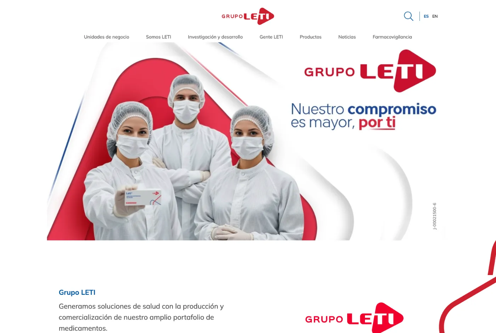
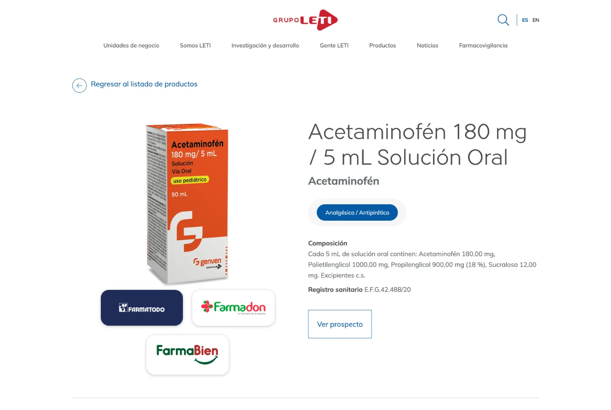
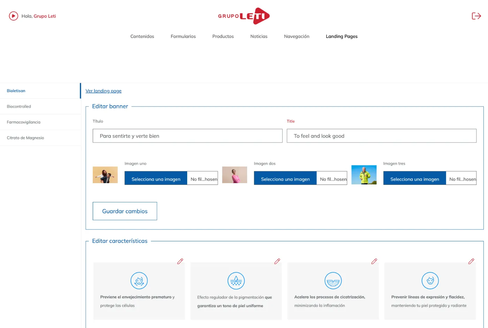

# Grupo Leti — Corporate website

Corporate website and content platform for **Grupo Leti**, a pharmaceutical group.
**Live:** https://grupoleti.com

> The source code is private (client project). This repository is a case study.

## My role

Full-stack development (front-end and API) and design improvements.

## Highlights

- **Three-layer design token system** in SCSS (primitive → semantic → component), fully documented, so spacing, typography and radii stay consistent across every component
- Product catalog with detail pages and search by product name or condition
- Admin panel to edit site content, including landing pages
- Careers flow with CV uploads, scanned for malware (ClamAV) on the API before storage
- Bilingual site (ES / EN)

### Product detail page

### Admin panel

## Stack

React · SCSS design tokens · Node · Express · MongoDB · Firebase · ClamAV
